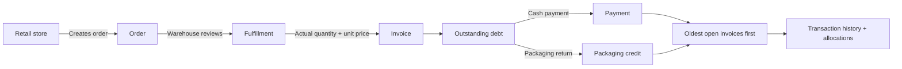
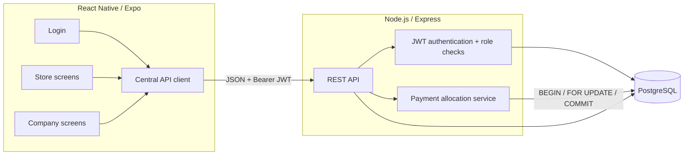
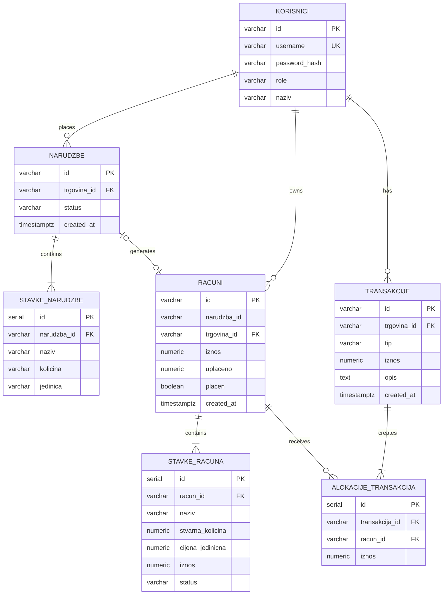
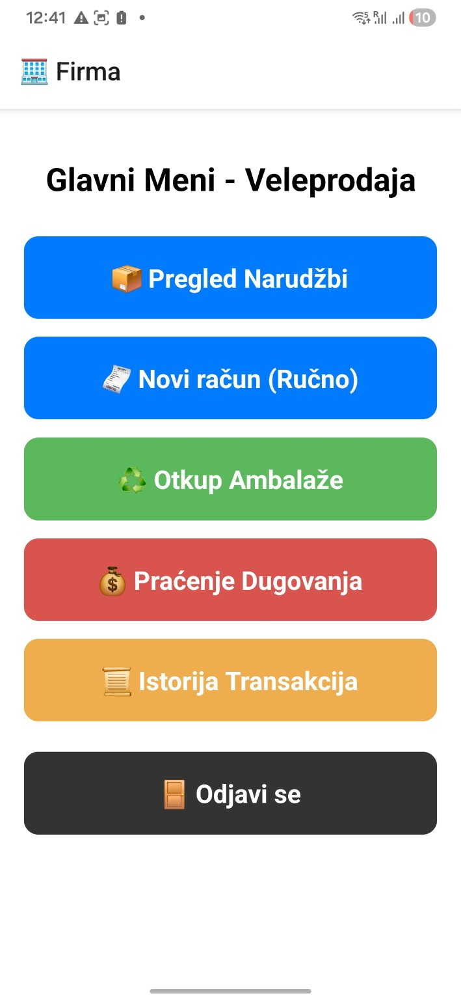
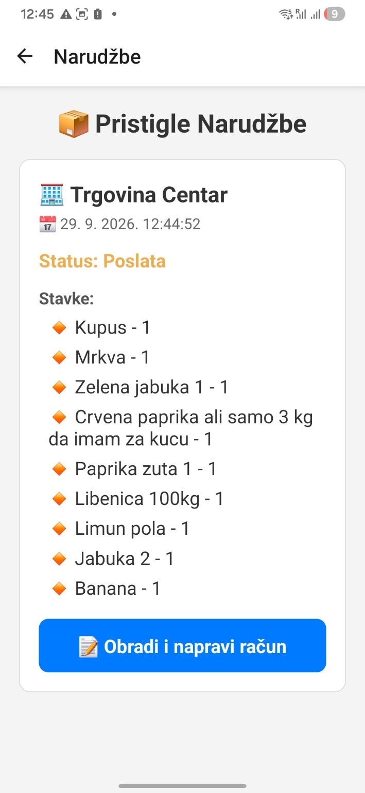
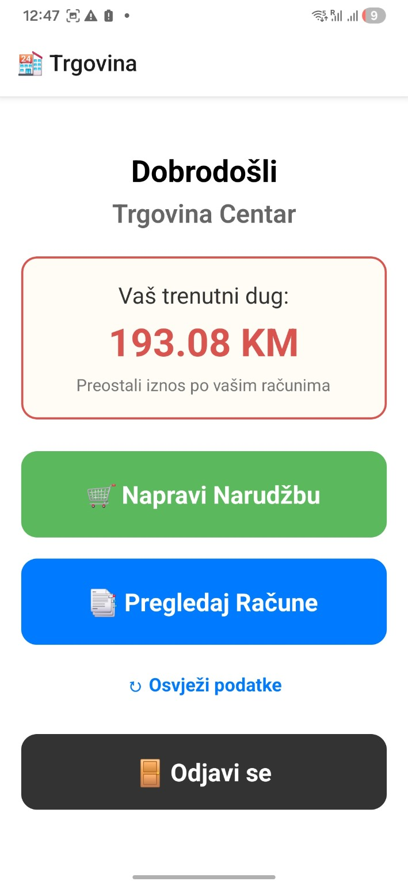

# B2B Wholesale Operations System

A mobile-first internal operations application for a wholesale distributor and its retail partners. The project covers the workflow from a store sending an order, through warehouse fulfillment and invoicing, to debt tracking, partial payments, packaging returns and transaction history.

The project started as a functional MVP and was later refactored around a stricter backend boundary: authentication and authorization are enforced server-side, financial allocation is transactional, store data is isolated by the authenticated user, and invoice/payment records are structured and auditable.

## What the system solves

Wholesale ordering often starts informally: a store asks for products in natural business language, the warehouse later confirms what is actually available, and the final quantity can differ from the original request. The application keeps that workflow simple for the store while giving the wholesaler a clear operational and financial view.

There are two roles:

- **Store (`trgovina`)** — signs in, sends free-form product requests, sees its own invoices and current debt.
- **Wholesale company (`firma`)** — reviews incoming orders, records actual fulfilled quantities and prices, marks unavailable items, creates invoices, records cash payments or packaging returns, and reviews transaction history.

> The free-form order field is intentionally an input workflow, not an NLP parser. Actual fulfillment data is confirmed by the warehouse when the invoice is created.

## Main workflow



## Key features

- JWT authentication with role-based authorization.
- Passwords stored as bcrypt-compatible hashes rather than plaintext.
- Server-side data ownership: a store can only receive its own invoices.
- Store identity for new orders comes from the verified JWT, not from client-supplied IDs.
- Free-form ordering with product suggestions for a fast mobile workflow.
- Warehouse fulfillment with actual quantity, price and **out of stock** handling.
- Manual invoice creation for warehouse/direct sales.
- Structured invoice items in PostgreSQL.
- Server-generated UUIDs and authoritative timestamps for new business records.
- Partial payments and packaging-return credits.
- Oldest-invoice-first payment allocation (“waterfall”).
- `SELECT ... FOR UPDATE` plus a PostgreSQL transaction for payment allocation.
- Allocation audit trail showing how each transaction was distributed across invoices.
- Transaction history sourced from PostgreSQL.
- Focused automated tests for authentication/authorization middleware and payment allocation.

## Architecture



### Technology stack

| Layer | Technology |
|---|---|
| Mobile client | React Native, Expo, React Navigation |
| API | Node.js, Express |
| Database | PostgreSQL |
| Authentication | JWT, bcryptjs |
| Client session | AsyncStorage |
| Testing | Node.js built-in test runner |

## Database model



## Why the payment flow lives on the backend

The first MVP calculated payment distribution on the mobile client. That worked functionally, but it allowed the client to decide how invoices should be updated and required separate requests for invoice updates and transaction history.

The refactored flow sends only the business intent to the API: **store, transaction type and amount**. The backend then:

1. starts a PostgreSQL transaction;
2. locks the store's open invoices with `FOR UPDATE`;
3. sorts them from oldest to newest;
4. validates the requested amount against the current debt;
5. calculates the allocation in cents to avoid floating-point money errors;
6. creates the transaction record;
7. updates every affected invoice;
8. stores an allocation record for each affected invoice;
9. commits everything together, or rolls everything back on failure.

This means an invoice update cannot succeed while the corresponding transaction record fails, and two concurrent payments cannot silently allocate against the same stale invoice state.

## Security and authorization

The API does not rely on the UI for access control.

- Login returns a signed JWT.
- Protected routes verify the `Authorization: Bearer <token>` header.
- Role middleware separates company-only and store-only operations.
- A store cannot choose another store ID when creating an order; the backend uses the authenticated JWT subject.
- The store invoice endpoint filters by the authenticated user's ID on the server.
- Secrets and local database credentials are kept in `.env`, which is excluded from Git. `.env.example` documents required configuration without exposing credentials.

## Screenshots

<table>
<tr>
<td width="50%"></td>
<td width="50%"></td>
</tr>
<tr>
<td align="center"><strong>Company operations menu</strong></td>
<td align="center"><strong>Store order workflow</strong></td>
</tr>
<tr>
<td width="50%"></td>
<td width="50%"></td>
</tr>
<tr>
<td align="center"><strong>Incoming order for warehouse processing</strong></td>
<td align="center"><strong>Store debt overview</strong></td>
</tr>
</table>

## Running locally

### Prerequisites

- Node.js and npm
- PostgreSQL
- Expo Go or another supported React Native development target

### 1. Backend

```bash
cd bracazoric-backend
npm install
```

Copy the example environment file to `.env` and fill in your local values:

```env
PGUSER=postgres
PGPASSWORD=your_postgres_password
PGHOST=localhost
PGPORT=5432
PGDATABASE=bracazoric
PORT=5000
JWT_SECRET=replace_with_a_long_random_secret
JWT_EXPIRES_IN=8h
```

Create the PostgreSQL database, then initialize the schema:

```bash
npm run init-db
npm start
```

### 2. Frontend

```bash
cd bracazoric-frontend
npm install
```

Set `BASE_URL` in `config.js` to the backend address reachable from the device running Expo. For a physical phone on the same Wi-Fi network, use the computer's LAN IPv4 address rather than `localhost`.

Example:

```js
export const BASE_URL = "http://192.168.1.100:5000/api";
```

Then start Expo:

```bash
npm start
```

### Demo accounts

The local seed data includes demo-only users:

| Role | Username | Password |
|---|---|---|
| Company | `firma` | `123` |
| Store | `trgovina1` | `123` |
| Store | `trgovina2` | `123` |

These credentials are intentionally simple local demo data and should be changed before any non-local deployment.

## Tests

Run backend tests with:

```bash
cd bracazoric-backend
npm test
```

Current suite: **11 focused tests** covering JWT/role middleware and payment-allocation behavior, including partial payment, multi-invoice waterfall allocation, previously partially paid invoices, exact debt payoff, overpayment rejection and invalid amounts.

The project also passed a manual end-to-end smoke test covering:

`store order → company fulfillment → invoice → store debt → partial payment → transaction history → packaging return → store isolation`

## Project evolution

The most important part of this project is not the number of screens; it is the architectural progression from a working MVP to a safer business workflow.

| MVP issue | Refactor |
|---|---|
| Plaintext-style login flow | bcrypt-compatible password hashing + JWT |
| Client-side authorization assumptions | Server-side JWT and role middleware |
| Store downloaded all invoices and filtered locally | Server filters invoices by authenticated store |
| Client supplied store identity | Backend derives store identity from JWT |
| Payment waterfall calculated on the phone | Backend payment allocation service |
| Invoice updates and transaction logging were separate requests | One PostgreSQL transaction |
| Potential concurrent stale payment updates | Row locking with `FOR UPDATE` |
| Invoice content mainly stored as text | Structured `stavke_racuna` records |
| Client-generated IDs/timestamps | Server-generated UUIDs and timestamps |
| History mixed local and server state | PostgreSQL as the source of truth |
| Critical logic untested | Focused automated tests |

## Current limitations / next improvements

This is a portfolio project and internal-workflow prototype, not a finished commercial ERP. Deliberate next steps would include:

- API integration tests against a dedicated test database;
- environment-based frontend API configuration instead of editing `config.js`;
- refresh-token/session lifecycle suitable for deployed mobile clients;
- stronger validation schemas and centralized API error handling;
- pagination for larger order/invoice histories;
- deployment, logging and monitoring;
- replacing remaining legacy text/date compatibility columns after a clean migration;
- optional structured parsing of requested order quantities if the business workflow requires it.

Overpayments are currently rejected rather than stored as account credit.

## Repository structure

```text
.
├── bracazoric-backend/
│   ├── middleware/
│   │   └── auth.js
│   ├── routes/
│   │   ├── auth.js
│   │   ├── orders.js
│   │   ├── racuni.js
│   │   └── transakcije.js
│   ├── services/
│   │   └── paymentAllocator.js
│   ├── tests/
│   ├── db.js
│   ├── init.js
│   ├── schema.sql
│   └── server.js
│
├── bracazoric-frontend/
│   ├── screens/
│   │   ├── Firma/
│   │   └── Trgovina/
│   ├── services/
│   │   └── api.js
│   ├── App.js
│   └── config.js
│
├── docs/
└── README.md
```

## What I would discuss in an interview

The strongest engineering discussion points are:

- why authentication is different from authorization;
- why store ownership must be enforced by the server;
- why financial allocation belongs in a database transaction;
- how `FOR UPDATE` prevents concurrent stale updates;
- why money calculations are converted to cents in application logic;
- why transaction allocations deserve their own audit table;
- how the project changed after reviewing the first working MVP rather than rewriting it from scratch.

A short interview/demo script is included in [`docs/INTERVIEW_GUIDE.md`](docs/INTERVIEW_GUIDE.md).
